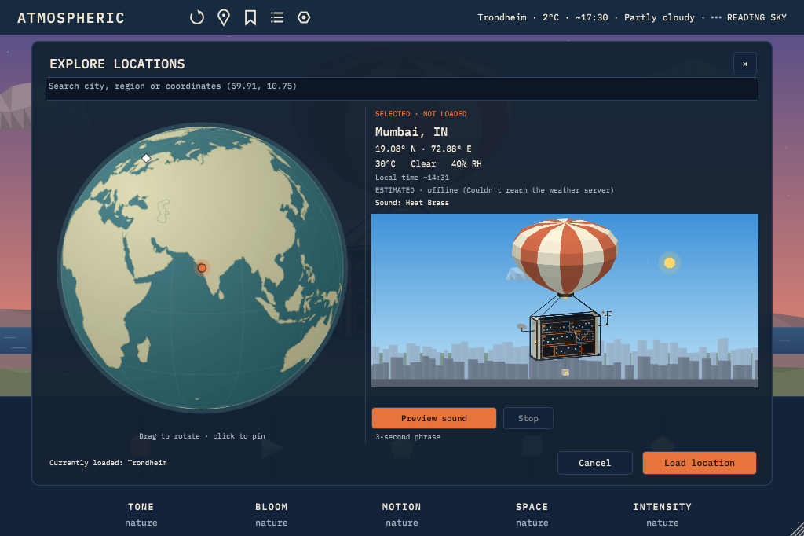

# World Atlas and Explore Locations

Addendum: "Weather Synth: World Atlas and Location Audition", 11 October 2026. Concept references: `design/references/atlas-browser.png` (the browser) and `design/references/world-atlas.png` (the twelve families). Concept art with illustrative conditions, not live weather or production assets.

## How it behaves

The header's place button opens **Explore Locations**. The instrument keeps playing and the header keeps showing what is loaded.

1. Search a city or region (OpenWeather geocoding through the relay, up to five results, debounced) or type coordinates (`59.91, 10.75`, `33.9 S 18.4 E`), or click the globe.
2. The candidate's weather is read (or the defined offline estimate, labelled ESTIMATED), its landscape resolved, and the card shows place, exact coordinates, temperature, condition, humidity, local time, source and age, the core sound it would play, and a still thumbnail of its scene.
3. **Preview sound** renders a fixed 3-second phrase with a separate instance of the real engine on a worker thread, then plays it through the host output at a fixed level. **Stop** fades it.
4. **Cancel** (or Esc, or the close button) drops the candidate. **Load location** commits exactly the Day that was shown and auditioned, swaps the whole scene, and makes that place the source of later "today" readings.

## Two domains

| Committed instrument | Browser candidate |
|---|---|
| `AtmosProcessor` Day, core sound, macros, scene, header, saved state | `ExploreBrowser::Candidate`: coordinates, label, prepared Day, thumbnail, audition clip |
| Changes only through `commitLocation` (Load) | Changes on every search, pin or reply |

- One function prepares a Day for both paths (`AtmosProcessor::prepareDay`): the candidate's core sound and the loaded one are the same by construction, and `patchFor` gives the exact patch with the current macros. Load does not re-query the weather.
- Each selection bumps a generation; late weather, geocoding, thumbnail and audition results from an earlier pin, a Cancel or a closed browser are dropped.
- The rendered phrase is keyed to the patch and sample rate; moving a macro invalidates it and the next Preview re-renders.
- Audition playback: the clip is published to the audio thread with a hazard-pointer hand-off (no locks, no allocation, no disk or network in `processBlock`). It is never saved, never plays in an offline render (the browser says so), and stops before Load, on Cancel and when the editor closes. A clip rendered for another sample rate does not play.
- Keep Day is untouched by browsing.

Tests (`testExplore`, run in CI): coordinate parsing; land/ocean lookup including the dateline; globe click and pin agree at the dateline and poles; deterministic, clean phrase; candidate selection, preview, save-during-preview and Cancel leave the instrument, saved state and header unchanged; rapid A/B keeps only B; a restore while a request is pending wins; offline rendering drops the audition; Load applies the auditioned snapshot, sound and patch.

## Landscape atlas

Twelve families plus neutral and open water (`gui/Landscape.cpp`): city, temperate, boreal, tropical, grassland, savanna, desert, Mediterranean, alpine, tundra/polar, coast/islands, wetland/delta. Each is a few flat, faceted silhouette bands drawn procedurally into the cached sky layer and tinted by the sky, so every weather and time of day applies to every family without extra art. Measured cost per frame: none (cached).

**Resolution** (`gui/LandscapeResolver.cpp`, version 1), geography only:

| Source | Rule | Confidence |
|---|---|---|
| curated | about 45 hand-picked places, within 40 km | 0.8 |
| ocean | Natural Earth 110 m land outline (public domain, already shipped for the globe) finds no land within about half a degree | 0.7 |
| none | everything else | neutral, 0 |

Never from temperature, humidity or precipitation. The user's **Scene style** (display settings) overrides the picture only.

## Hero fidelity (sky, clouds, city)

Goal: match `design/references/balloon-hero.png`, not approximate it.

- **Framing:** the scene runs under a transparent header (1024 x 504 logical, the macro band below); the envelope is cropped at the top as in the hero and the cabinet is about a quarter of the width.
- **Sky:** three-stop gradient (zenith holds most of the sky), a wide warm glow along the horizon around a low sun (sun altitude -10 to 18 degrees), larger low sun disc, retuned dusk/sunset keys.
- **Clouds:** `design/blender/export_backdrops.py` renders six faceted cumulus, lit by the same eight lighting anchors as the craft. The runtime mixes them by anchor weight (like the craft), darkens storm cells, and caches each cloud at screen size; it re-lights them only when the light changes. Without the art it falls back to the path clouds.
- **City:** two Blender layers per anchor: far (faceted ridges and a low skyline, hazed into the horizon colour at runtime) and near (slim towers with sparse lit windows, a cable-stayed bridge on the right, a dense near band). Windows light up from the anchor's lamp level. Drawn into the cached background, so it costs nothing per frame.

Rain alone now counts for less overcast (cloud cover decides), rain skies grey towards a cool slate instead of brown, and the overcast wash comes from the zenith colour, so a rainy dusk stays blue above and warm low down. The `mumbai_monsoon` demo fixture now has broken cloud, as in the hero.

Side by side: `gui/hero-vs-app-dusk.png` (app left, hero right), `gui/city-times.png` (monsoon and haze at dawn, noon, dusk and night).

Still different from the hero: the clouds are lavender and evenly lit (the hero's are slate with warm lit undersides); the horizon glow is weaker at the atlas's dusk (sun 6 degrees below the horizon; the hero shows it on the horizon); the envelope stripes and cabinet are the existing craft art.

Re-render: `xvfb-run -a blender -b --factory-startup --python design/blender/export_backdrops.py -- [--parts clouds,city] [--anchors dusk] [--fast] [--out dir]`, then reconfigure CMake (the art is compiled in).

## Not done yet (honest list)

- Composable overlays (city + coast + terrain together) and season/ground-cover inputs; today one family per place.
- A worldwide classifier: needs a validated source (for example a build-time, size-measured class grid from land cover plus elevation), a licence review and a version; not shipped.
- Globe/Search tabs at the smallest sizes (the panel scales instead), a 2D map fallback, keyboard arrow navigation through results (Tab works).
- Pausing the hidden scene's animation while the browser is open.
- Blender-authored family layers: **city is done** (see below); the other eleven families are still procedural and follow one at a time, each checked side by side against the reference.
- Host checks of the audition (realtime playback, stopped transport, offline bounce) in real DAWs.
